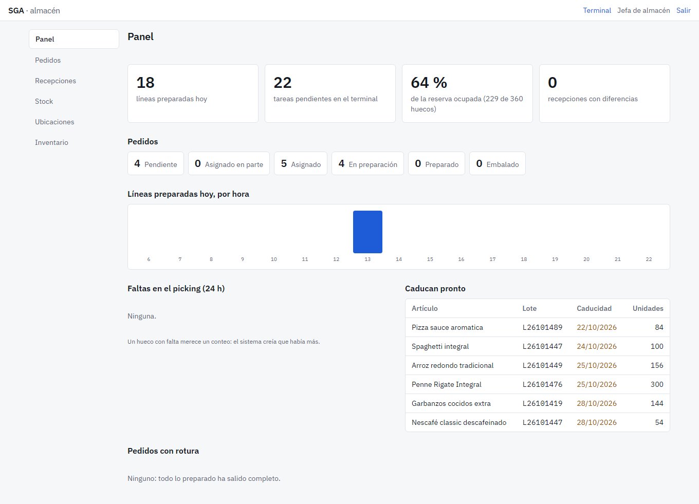
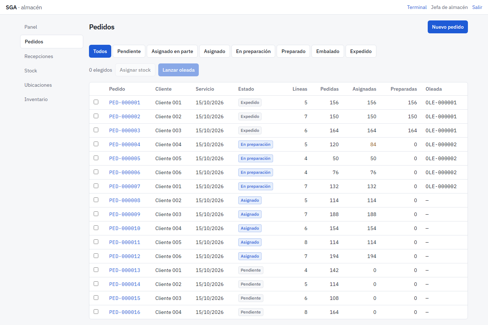
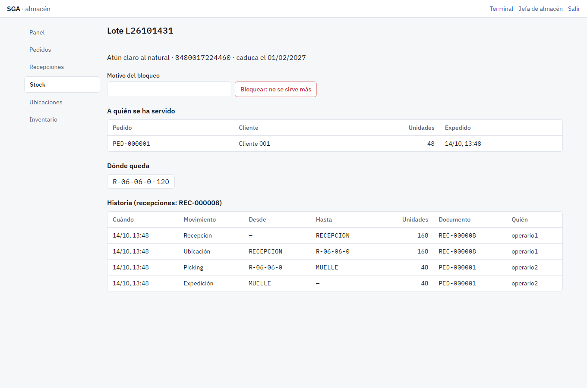
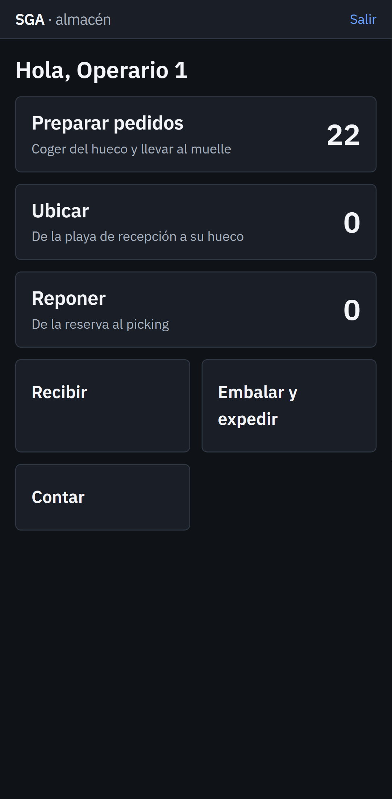
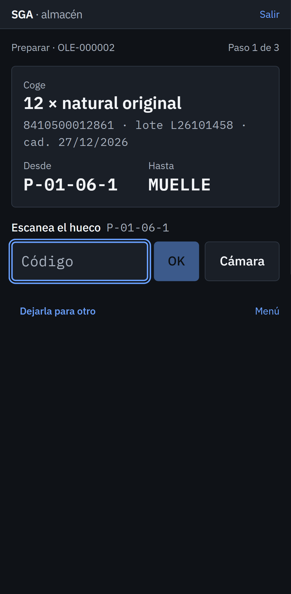
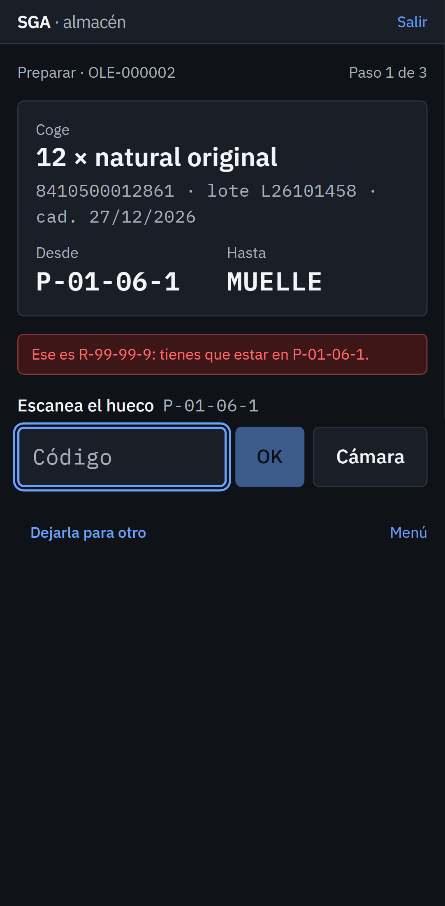

# SGA · sistema de gestión de almacén

Un **SGA (WMS)** para un almacén de distribución de alimentación: recibe la mercancía de los proveedores, la ubica,
lleva el stock por ubicación y lote con su caducidad, prepara los pedidos de los clientes, los embala con su
etiqueta SSCC y los expide, con inventarios cíclicos y la trazabilidad de cada lote.

Dos caras en la misma aplicación: la **oficina** (pedidos, recepciones, stock, panel) y el **terminal** del
operario, en el móvil o en una PDA, donde cada paso se confirma **escaneando**.

**.NET 10 · ASP.NET Core · EF Core · PostgreSQL · React 19 · TypeScript · TanStack Router y Query · Tailwind CSS ·
SignalR · QuestPDF · xUnit · FsCheck · Testcontainers · Playwright + axe**

| Panel | Pedidos |
|---|---|
|  |  |

| Trazabilidad de un lote | Terminal: menú | Terminal: una tarea | Terminal: hueco equivocado |
|---|---|---|---|
|  |  |  |  |

Los artículos son reales: EAN, nombre, marca y formato de productos vendidos en España, de
[Open Food Facts](https://world.openfoodfacts.org) (licencia ODbL, ver [datos/LICENSE-ODbL.md](datos/LICENSE-ODbL.md)),
así que sus códigos de barras se pueden escanear con productos de casa. El mapa del almacén, los proveedores, los
clientes, el stock y los pedidos son **datos de demostración** generados al arrancar.

> **In English.** Warehouse management system (WMS) for a food distribution warehouse: receiving, put-away, stock by location and lot with expiry dates (FEFO), order picking, packing with GS1 SSCC labels, shipping, cycle counts and full lot traceability. An office web app and a scanner terminal for operators where every step is confirmed by scanning. Built with .NET 10, EF Core and PostgreSQL on the back end and React 19 with TypeScript on the front end, tested with xUnit, property-based tests, Testcontainers and Playwright.

## Qué hace

- **Entradas.** Recepciones previstas por proveedor; al descargar se escanea cada bulto (EAN suelto o etiqueta
  GS1-128 con lote, caducidad y cantidad), lo dañado va a cuarentena y lo bueno sale con su **tarea de ubicar** al
  hueco que sugiere el almacén: primero el picking del artículo hasta su máximo y el resto a un hueco de reserva vacío
  cerca de él. Al cerrar, las diferencias quedan a la vista.
- **Stock por ubicación y lote**, con disponible, reservado, lotes bloqueados y ubicaciones en recuento.
- **Salidas.** Pedidos con fecha de servicio; el stock se reparte por **FEFO** (primero lo que antes caduca)
  respetando la vida útil mínima que pide cada cliente y saltándose lotes bloqueados, cuarentena y huecos que se
  están contando. Los pedidos se agrupan en **oleadas** y el operario recorre el almacén en **serpentina**. Si en el
  hueco falta mercancía, lo que falta se busca en otro sitio y queda como incidencia.
- **Reposición** automática del picking desde la reserva cuando baja de su mínimo.
- **Embalaje y expedición**: bultos con su **SSCC** (GS1-128), etiqueta y albarán en PDF.
- **Inventario cíclico ciego**: quien cuenta no ve lo esperado; lo que no cuadra se recuenta y el ajuste necesita
  la aprobación del jefe de almacén. Mientras se cuenta, las ubicaciones quedan bloqueadas.
- **Trazabilidad de un lote** para una retirada: de qué recepción vino, por dónde ha pasado, a qué clientes ha ido y
  dónde queda.
- **Panel** en tiempo real: pedidos por estado, ritmo de preparación, ocupación, faltas, caducidades y roturas.
- Roles: *Administrador*, *JefeDeAlmacen*, *Operario* y *Administracion*, comprobados en la API.

## Cómo está hecho

```
src/
├── Sga.Dominio/           Las reglas, sin dependencias
│   ├── Codigos/           GTIN (EAN-13), lectura de GS1-128 (AI 00, 01, 10, 15, 17, 37) y SSCC con dígito de control
│   ├── Stock/             Existencia, Movimiento (libro), Reserva, asignación FEFO
│   ├── Almacen/           Ubicaciones, recorrido en serpentina, ubicación sugerida, tareas
│   ├── Entradas/ Salidas/ Recepción; pedido con preparación y embalaje; oleada
│   └── Inventario/        Conteo ciego con recuento y aprobación
├── Sga.Aplicacion/        Casos de uso (entradas, salidas, tareas, reposición, inventario) y consultas
├── Sga.Infraestructura/   PostgreSQL (EF Core, un esquema por módulo, bloqueo por fila), Identity, PDF
└── Sga.Api/               Minimal APIs, cookie de sesión, SignalR, OpenAPI, base de demostración
web/                       React: oficina y terminal (PWA con escáner por lector y por cámara)
datos/                     Artículos de Open Food Facts y el script que los descarga
```

Lo más interesante, con su decisión explicada:

- **El stock es un libro de movimientos que nunca se borra** y unas existencias que se actualizan en la misma
  transacción; la base de datos tiene además las restricciones del stock. Una prueba de propiedades comprueba con
  500 secuencias aleatorias en cada ejecución que el libro cuadra siempre. → [ADR 1](docs/decisiones/0001-libro-de-stock.md)
- **Concurrencia**: bloqueo por fila en orden fijo, existencias que se crean sin carreras y concurrencia optimista en
  las tareas; con pruebas de diez operarios a la vez sobre el mismo hueco. → [ADR 2](docs/decisiones/0002-concurrencia.md)
- **Monolito modular** con el dominio aislado, sesión por cookie y un front con dos caras.
  → [ADR 3](docs/decisiones/0003-monolito-modular-y-front.md)

## Ponerlo en marcha

Con Docker, todo junto (la API con el front dentro y PostgreSQL, con la base de demostración):

```bash
docker compose --profile completo up --build
```

Y en <http://localhost:8080>, con la contraseña `almacen-demo` (solo de la demo local):

| Usuario | Rol | Para ver |
|---|---|---|
| `jefa` | Jefa de almacén | Oficina y terminal: panel, oleadas, inventario |
| `operario1`, `operario2` | Operarios | El terminal (mejor en el móvil o con el navegador en modo móvil) |
| `oficina` | Administración | Pedidos, recepciones y stock |

Para desarrollar: `docker compose up -d postgres`, `dotnet run --project src/Sga.Api` (API en el 5080 con la demo)
y `npm run dev` en `web/` (front en <http://localhost:5173>).

Para escanear con el móvil, imprime las etiquetas de ubicación desde *Ubicaciones* y usa los EAN de productos de casa.

## Pruebas

| Dónde | Qué |
|---|---|
| `tests/Sga.Arquitectura.Tests` | Los límites entre capas: el dominio no depende de EF ni de ASP.NET, cada módulo solo usa los de debajo y las entidades no tienen setters públicos |
| `tests/Sga.Dominio.Tests` | Códigos GS1, libro de stock (con una prueba de propiedades), FEFO, ubicación sugerida, recorrido, tareas, recepción, pedido y conteo |
| `tests/Sga.Integracion.Tests` | Contra PostgreSQL (Testcontainers): de la recepción a la expedición, reposición, faltas, cuarentena, vida útil y lotes bloqueados, conteo con ajuste y concurrencia (asignaciones, picking y tareas a la vez, las últimas líneas de una oleada y dos cambios sobre el mismo pedido); al final de cada uno, el libro cuadra en SQL |
| `tests/Sga.Api.Tests` | La API entera: sesión, bloqueo de la cuenta, cookie, permisos de cada rol, conteo ciego, errores RFC 9457 y cabeceras de seguridad |
| `web` (Vitest) | Lectura de etiquetas GS1 en el terminal |
| `web/e2e` (Playwright) | Oficina en escritorio (panel, pedido → asignación → oleada, trazabilidad) y terminal en móvil (preparar escaneando, hueco equivocado, recibir con etiqueta GS1, conteo ciego), con axe en cada pantalla |

En total: 54 de dominio, 8 de arquitectura, 15 de integración, 8 de la API, 8 del front y 12 de extremo a extremo.
La CI (`.github/workflows/ci.yml`) las pasa todas, además del formato, los paquetes con vulnerabilidades, que las
migraciones estén al día y que la imagen Docker se construya.

Con la demo en marcha, `node capturas.ts http://localhost:8080` (en `web/`) rehace las capturas.

## Licencia

Código: MIT. Datos de artículos: Open Food Facts, ODbL 1.0.
